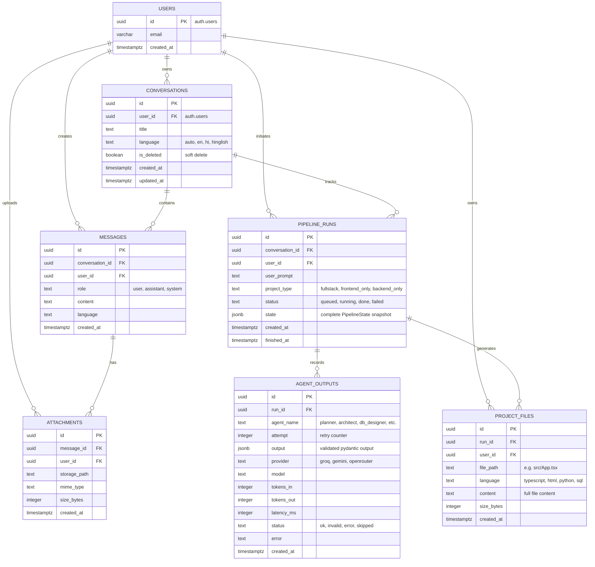

# Entity Relationship Diagram (ERD) — AI Software Team

This document represents the database schema designed for **Supabase (PostgreSQL)** with strict **Row Level Security (RLS)**.

---

## 1. Visual ERD (Mermaid)

---

## 2. Table Descriptions & Row Level Security (RLS) Rules

| Table | Purpose | Row Level Security (RLS) Rule |
| :--- | :--- | :--- |
| `conversations` | Grouping user chat sessions | `auth.uid() = user_id` (Only creator can view/update) |
| `messages` | Chat history stream | `auth.uid() = user_id` |
| `attachments` | Uploaded images & document metadata | `auth.uid() = user_id` |
| `pipeline_runs` | Execution lifecycle & state snapshot | `auth.uid() = user_id` |
| `agent_outputs` | Latency, token usage, per-agent audit | `EXISTS (SELECT 1 FROM pipeline_runs WHERE id = agent_outputs.run_id AND user_id = auth.uid())` |
| `project_files` | Physical files generated for download/push | `auth.uid() = user_id` |

---

## 3. How to use in dbdiagram.io
1. Open [dbdiagram.io](https://dbdiagram.io) in your browser.
2. Open [docs/ERD.dbml](file:///c:/Users/asus/OneDrive/Desktop/multi%20agant/docs/ERD.dbml).
3. Copy all lines and paste into the editor.
4. Your interactive ERD diagram will generate automatically with all foreign keys and relationship lines.
